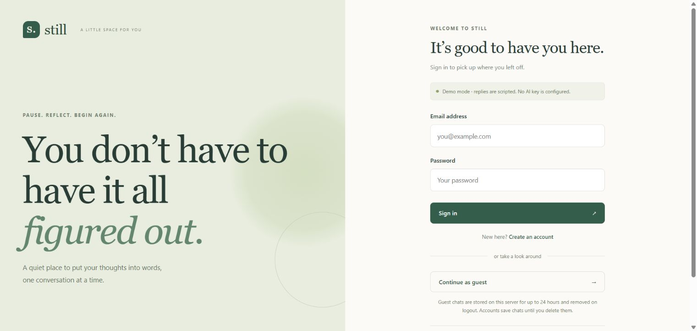
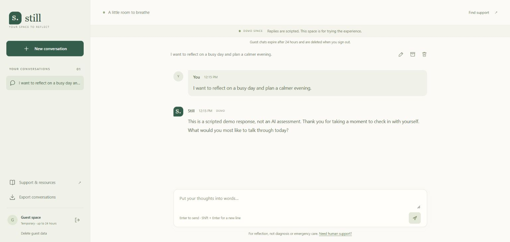

# Still — Mental Health Chatbot

## Tested screenshots

Captured from the running local full-stack application on November 7, 2026 with fictional guest text. The scripted demo is explicitly labeled; no live AI-provider inference was tested or claimed. The initial 16 backend tests passed, and the production frontend build completed successfully.






A complete local full-stack reflection companion, built from the original frontend project. React + TypeScript + Vite on the client; a Node.js HTTP API and persistent SQLite database on the server.

## Quick start (Windows / PowerShell)

Install **Node.js 24.14 or newer**. Install Git if you want to use the clone command below. No Python or external database service is needed.

Open PowerShell in the folder where you want to keep the project:

```powershell
git clone https://github.com/JaiKaushik03/Mental-Health-Chatbot.git
cd Mental-Health-Chatbot
npm.cmd ci
npm.cmd run dev
```

Alternatively, use **Code → Download ZIP** on GitHub, extract it, and open PowerShell in the extracted folder containing `package.json`. Skip the `git clone` and `cd` lines and run the two `npm.cmd` commands. To inspect or edit the code, open that same project folder in your editor.

Open **http://localhost:5173**. The development command starts both frontend and backend. Use the exact localhost address: browser writes are restricted to the configured UI origin. Stop with Ctrl+C.

You can create an account or continue as a guest immediately. Without an API key, the app clearly labels itself as a **scripted demo**. Demo replies are templates, not AI or a clinical assessment. Authentication, persistence, conversation management, export, and deletion work in demo mode.

## Enable AI replies (optional)

Copy `.env.example` to `.env`, add your own OpenAI API key, and restart the server:

```dotenv
OPENAI_API_KEY=your-key-here
OPENAI_MODEL=gpt-4.1-mini
```

The model is configurable; your OpenAI project must have access and billing enabled. Never put the key in a `VITE_` environment variable. Keys stay on the server and are excluded from Git. No live paid provider request was made during development; the provider flow is covered with mocked contract tests.

The backend sends recent conversation context (up to 20 messages) through the [Responses API](https://developers.openai.com/api/docs/guides/conversation-state), with `store: false`. It checks user text and generated output through the [Moderation API](https://developers.openai.com/api/docs/guides/moderation). Local explicit-risk patterns return a human-support message even when the provider is unavailable. Provider errors are surfaced to the user; the server does not silently switch an AI session to scripted replies. Moderation and keywords are imperfect and do not establish that a conversation is safe.

## Included features

- Email/password registration and login, hashed/salted passwords, and server-validated HttpOnly cookie sessions.
- Persistent accounts, temporary guest sessions, and enforced ownership for every conversation request.
- Context-aware AI chat or clearly labeled scripted demo chat.
- Message/reply pairs saved in one transaction; retry IDs prevent duplicate exchanges after an interrupted response.
- Create, rename, archive, restore, and delete conversations.
- Export all your conversations as JSON; delete your account and its data.
- Responsive desktop/mobile layout, keyboard controls, accessible labels, confirmation dialogs, connection/error states, and resource links.
- Input limits, rate limits, same-origin write checks, parameterized SQL, and production security headers.

## Data and privacy

- SQLite is created automatically at `data/still.sqlite`. Back up the database with the server stopped, including any associated WAL files. This folder is ignored by Git.
- Registered conversations remain until the user deletes the conversation/account. Sessions expire after seven days; users can sign in again without losing chats.
- Guest sessions last 24 hours without renewal. Logout or data deletion removes guest data immediately. Expired guest rows are cleaned on requests and by a one-minute timer while the server is running; cleanup resumes on startup activity if it was stopped.
- Chats are stored **unencrypted on disk**. Protect the machine and its backups. Deleting app data does not erase copies in prior backups or third-party systems. SQLite secure-delete is enabled, but filesystem/backup recovery is outside this app’s guarantees.
- AI mode sends messages to OpenAI for safety checks and response generation; `store: false` does not imply zero provider retention. Review the provider’s data policies before using sensitive information.
- Guest does not mean anonymous: requests pass through this server. Avoid entering identifying or sensitive details.

## Run the built app

```powershell
npm.cmd run build
```

For `npm start`, remove `APP_ORIGIN` from `.env` (the default becomes `http://localhost:3001`) or set it explicitly:

```dotenv
APP_ORIGIN=http://localhost:3001
```

```powershell
npm.cmd start
```

Open **http://localhost:3001**. The backend serves the built UI, API, and SPA routes together. `npm run preview` previews only the frontend build; use `npm start` for the complete app.

For a hosted deployment, set `HOST=0.0.0.0`, `APP_ORIGIN` to the exact HTTPS public origin, and `COOKIE_SECURE=true`; terminate TLS with your hosting platform/reverse proxy. Keep `DATABASE_PATH` on durable local storage, not an ephemeral container filesystem or a live cloud-synced folder. This implementation uses one Node process and local SQLite; the rate limits and in-flight locks are per-process.

This is a runnable local application, **not a clinically validated service or a production healthcare platform**. Before serving real users, arrange appropriate security/privacy and clinical review, retention policies, abuse monitoring, and hosting operations. Email verification, password recovery, and human crisis monitoring are not implemented.

## Configuration

| Variable         | Default                                                                          | Purpose                                    |
| ---------------- | -------------------------------------------------------------------------------- | ------------------------------------------ |
| `OPENAI_API_KEY` | empty                                                                            | Empty means scripted demo                  |
| `OPENAI_MODEL`   | `gpt-4.1-mini`                                                                   | Text generation model                      |
| `PORT`           | `3001`                                                                           | Backend port                               |
| `HOST`           | `127.0.0.1`                                                                      | Listening interface                        |
| `APP_ORIGIN`     | `http://localhost:5173` in development; `http://localhost:3001` with `npm start` | Allowed browser write origin               |
| `COOKIE_SECURE`  | `false`                                                                          | Enable for HTTPS deployment                |
| `DATABASE_PATH`  | `data/still.sqlite`                                                              | SQLite path; `:memory:` for isolated tests |

The Vite development proxy points to port 3001. If you change the backend development port, update `vite.config.ts` too. The old `VITE_BE_BASE_URL` setting is no longer used.

## Verification

The development dependency override for `@typescript-eslint/typescript-estree` pins a patched minimatch release to address [GHSA-g3hv-75wg-m249](https://github.com/advisories/GHSA-g3hv-75wg-m249). Remove the override when the upstream linter adopts the fix. The complete dependency audit reported zero advisories after updates.

```powershell
npm.cmd run check
```

Runs ESLint, 16 Node tests, TypeScript checking, and the production build. Backend tests cover ownership, passwords, sessions, expiry, atomic sends, retries, concurrent requests, rate limiting, deletion, persistence, and provider contracts/failures.

Browser verification uses Playwright against an isolated, in-memory demo server on port 3101. Build first:

```powershell
npm.cmd run build
npx.cmd playwright install chromium
npm.cmd run test:e2e
```

Or use installed Microsoft Edge:

```powershell
$env:PLAYWRIGHT_CHANNEL = 'msedge'
npm.cmd run test:e2e
```

The 12 browser checks run the major flows at desktop and mobile sizes, including server-committed responses lost in transit. Screenshots are written to `artifacts/` and failure traces to `test-results/`.

## API map

All routes are under `/api`. JSON writes require `Content-Type: application/json`. Authenticated routes use the session cookie, not a client-supplied user ID.

| Method        | Route                           | Purpose                                     |
| ------------- | ------------------------------- | ------------------------------------------- |
| GET           | `/health`, `/auth/session`      | Health and current session/mode             |
| POST          | `/auth/register`, `/auth/login` | `{email, password}`                         |
| POST          | `/auth/guest`, `/auth/logout`   | Start guest session / end session           |
| GET, POST     | `/conversations`                | List / create                               |
| PATCH, DELETE | `/conversations/:id`            | Rename/archive/restore / delete             |
| GET, POST     | `/conversations/:id/messages`   | History / send `{content, requestId}`       |
| GET           | `/export`                       | Export this user's data                     |
| DELETE        | `/account`                      | Delete this user with `{confirm: "DELETE"}` |

## Project layout

```text
src/components/    Auth, chat, resources, and icons
src/services/      Typed same-origin API client
server/            HTTP routes, authentication, SQLite, AI, and backend tests
e2e/               Desktop/mobile browser tests
scripts/           Development and built-app launchers
```

## Troubleshooting

- **Cannot connect:** run `npm run dev` for development, or build then `npm start` for the full built app. The frontend needs its backend.
- **Origin not allowed:** use `http://localhost:5173` in development; check `APP_ORIGIN` against the address bar, including scheme and port. `127.0.0.1` and `localhost` are different origins.
- **Reply service unavailable:** check API key, billing, model access, and provider/network availability. Retry keeps the request ID for the same draft to avoid duplicates.
- **Session repeatedly expires:** do not enable secure cookies on plain local HTTP; check the server clock.
- **Port already in use:** stop the previous server or choose another backend port and update the dev proxy.
- **SQLite experimental warning:** Node 24 labels its built-in SQLite API experimental; the warning is expected on the verified runtime (Node 24.14.0).


## Reliability and local performance verification

The review branch adds database-backed GET/HEAD readiness checks at `/api/health`. Readiness does not require a session or consume the application rate-limit budget. An unavailable database returns HTTP 503 with no private state.

Verified locally on November 12, 2026: **20 backend tests pass**, ESLint passes, and the production frontend build succeeds. The new tests cover anonymous readiness, HEAD semantics, readiness during application rate limiting and database failure.

Run `node scripts/benchmark-api.mjs` for a fixed synthetic workload: 100 conversations in a temporary on-disk SQLite database, ten warm-up reads and 100 authenticated GET requests at each concurrency level (1 and 8). Raw latency samples and environment details are in [the benchmark JSON](docs/benchmarks/api-results.json). This run completed 200 measured requests with zero errors. At concurrency 8, p95 was approximately 14.42 ms on the recorded local machine. These are loopback API measurements, not external-network, AI-inference or sustained production-load results.

### Container setup

```bash
docker build -t still-demo .
docker run --rm -p 127.0.0.1:3001:3001 -v still-data:/data still-demo
```

Open `http://localhost:3001`. The image runs as a non-root user and uses a persistent volume for SQLite. The initial configuration is a scripted demonstration with no paid provider key. For an approved hosted deployment, configure the exact HTTPS origin and secure cookies as described above; do not expose private chats or provider secrets.

A GitHub Actions workflow runs lint, tests, frontend build and the synthetic API benchmark. A separate job builds and smoke-tests the container. Docker is unavailable on the local validation machine, so container behavior is not labelled locally verified; inspect the actual workflow result before making a container-runtime claim. No public service has been deployed by this change.
